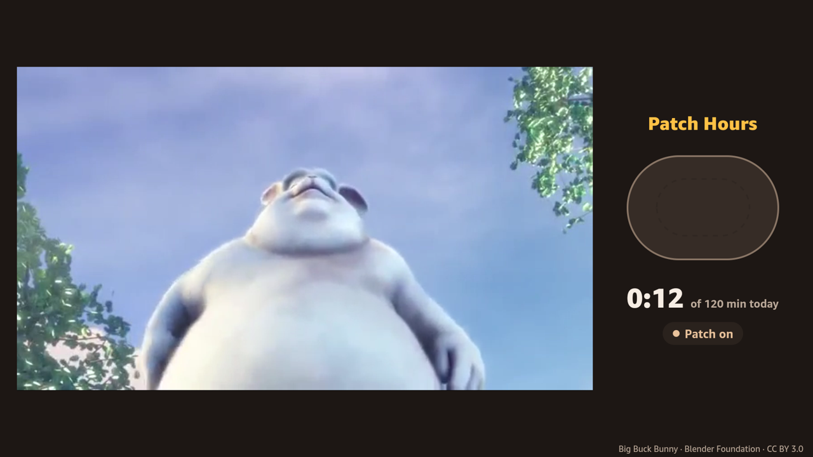
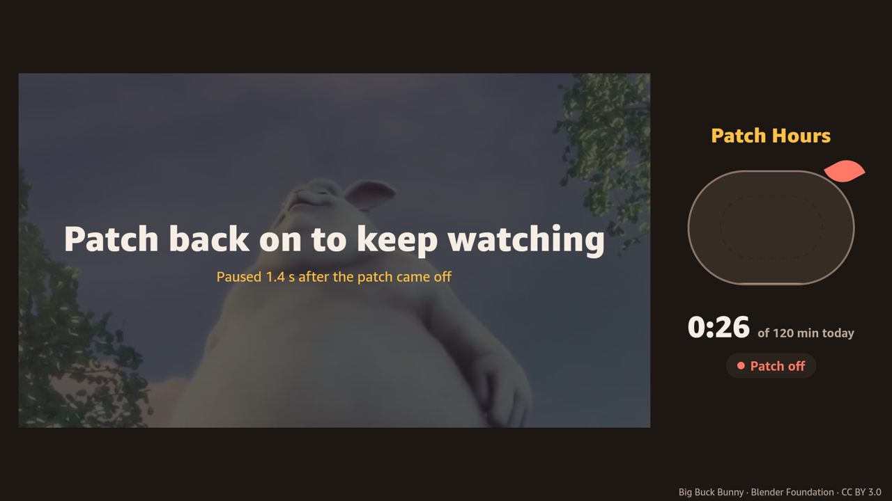

# Patch Hours

**The show plays only while the eye patch is on.** A Fire TV app and a phone check for children patching for amblyopia (lazy eye): the cartoon pauses when the patch comes off, and the minutes the phone saw the patch on are counted.

- **Video (2:43):** https://youtu.be/g5KP7FcY02Q
- **Live:** https://patch-hours.vercel.app (the TV screen in a browser, with a scripted run for judges without a phone)
- **Phone check:** https://patch-hours.vercel.app/check

| Patch on: the show plays | Patch off: the show pauses |
|---|---|
|  |  |

## Why

About half of the patching prescribed to children is never worn. In 152 children whose patching was measured by an occlusion dose monitor, mean compliance was 44% and on 42% of days no patch was worn at all ([Wallace et al., IOVS 2013](https://openaccess.city.ac.uk/id/eprint/2796)). A 2026 review puts adherence at 40 to 60% by week 6 and about 30% by week 12 ([OEPF](https://www.oepf.org/wp-content/uploads/2026/07/OVP-14-2-Chow-Final-New-Newest.pdf)). Families keep diaries from memory. The TV is already the child's reward.

## How it works

1. **The TV shows a pairing code.** The parent scans it with their phone.
2. **The phone learns this patch.** The parent captures a few seconds of "patch on", "no patch" and "hand over the eye"; the phone trains a nearest-neighbour model on the eye crop, on the phone, and shows held-out precision and recall.
3. **The TV plays only while the patch is seen.** The phone sends on or off about twice a second. When the patch comes off, or the phone stops reporting, the show pauses with "Patch back on to keep watching"; the TV prints how long the pause took.

Minutes the camera saw are counted apart from minutes the parent adds by hand, so the orthoptist sees both.

## What's real and what's simulated

| Part | Status |
|---|---|
| Fire TV app (Vega SDK 0.24, React Native) on the Vega Virtual Device | real; no physical Fire TV was used |
| Phone check (camera, face landmarks, eye crop, on-device classifier) | real; demo footage uses an adult with a home-made patch |
| Pause and resume, minute counting, week sheet | real, through the deployed API |
| "Run the scripted check" on the home page | sends the same on/off signals a phone sends, on a script, for judges without a phone |
| Reward video | Big Buck Bunny, Blender Foundation, CC BY 3.0 |

Only the on/off flag, a class name, a confidence and timestamps leave the phone: the API rejects any other field and any body over 512 bytes. No pictures are sent or stored.

## Architecture

```
 Phone (/check)                      Vercel (Next.js API + Neon Postgres)          Fire TV (Vega app)
 camera -> face landmarks -> eye crop  POST /api/session/:code/flag  <-- on/off      poll every 1 s
        -> embedding -> kNN vote  ---> GET  /api/session/:code       --> playable?   play / pause the video
```

- `tv/`: Vega app. `src/App.tsx` plays or pauses only when the session's state changes; `src/session.ts` pairs and polls.
- `web/`: the API, the phone check, the web TV preview, the week sheet. Rules live in `web/lib/rules.ts` (when the TV may play, how minutes count) and the classifier in `web/lib/knn.ts`, both unit-tested.

Run the checks: `npm --prefix web test` · `npm --prefix tv test`.

## Run it yourself

**Try it without building anything:** open https://patch-hours.vercel.app, press **Run the scripted check**, then click the TV picture to start the show. For the real loop, scan the TV's code with a phone and follow the three steps on the phone page (a skin-coloured sticky note over one eye works as a patch).

**Web app and API** (Node 22):
```bash
cd web
npm install
npm run dev          # http://localhost:3000 — sessions are kept in memory
# optional: set DATABASE_URL (Postgres, e.g. Neon) in web/.env.local to persist sessions
```
The phone page needs the camera, so open it on `localhost` or over HTTPS.

**Fire TV app** (Vega SDK 0.24, Ubuntu x86_64 or macOS; under WSL2 also `sudo apt-get install libpulse0` and add yourself to the `kvm` group):
```bash
curl -fsSL https://sdk-installer.vega.labcollab.net/get_vvm.sh | bash   # Amazon's Vega SDK installer
cd tv
npm install
npm run build:debug
vega virtual-device start
vega run-app build/x86_64-debug/patchhours_x86_64.vpkg
```
The app talks to `https://patch-hours.vercel.app` by default. To use a local web app instead, set `USE_DEV = true` in `tv/src/config.ts` (the virtual device reaches your machine at `10.0.2.2`). On a physical Fire TV, `VIDEO_URL` can point at `bunny-tv-480.mp4` to play with sound (FRICTION_LOG.md, item 11).

## Limits

- An adherence aid for a prescribed patch. It does not treat amblyopia or change a prescription.
- Fire TV blocks apps from opening content inside other apps, so the reward plays inside Patch Hours.
- Tested on the Vega Virtual Device only, not on a physical Fire TV.
- The TV app makes a new pairing code each time it starts, so the phone pairs again (and is taught again) after a restart.
- Anyone holding a pairing code can send on/off signals for it; codes are random, six characters, and expire after 30 days.
- The held-out precision and recall come from frames captured in the same session, so they are an upper bound.

Built for the Build, Ship, Shape: Amazon Developer Hackathon. This repository was started on 20 October 2026; nothing in it existed before the event. AI tools used: Claude Code (planning and code). See [FRICTION_LOG.md](FRICTION_LOG.md) and [FEEDBACK.md](FEEDBACK.md).
